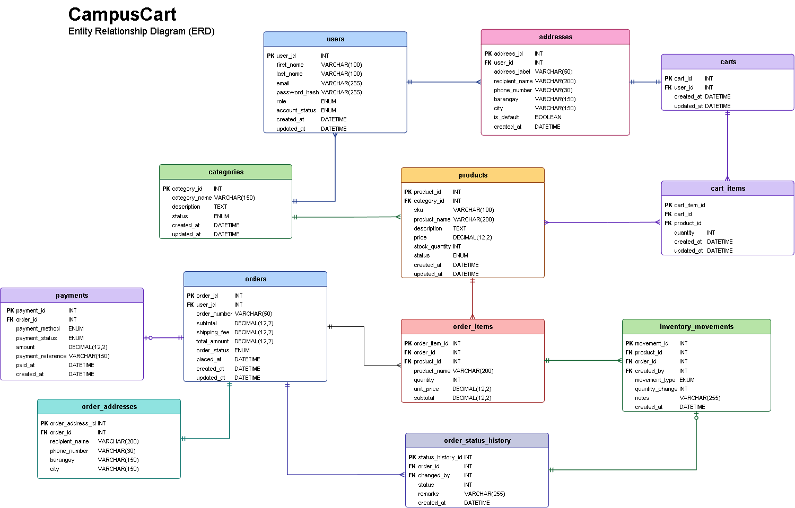

# ITE 18 – Application Development and Emerging Technologies
## MIDTERM PROJECT DOCUMENTATION — FRONTEND TRACK

**Project:** CampusCart: A Web-Based E-Commerce Platform for Student Essentials and Campus Merchandise  
**Members:** Laurence Paul Jigger R. Egay; Joshua Frank Lubguban Galve  
**Specialization:** Frontend  
**Section:** ITE-18 BJEM1  
**Instructor:** Glaicel Araneta  
**School year:** Semester A.Y. 2026–2027  
**Date of submission:** **[CONFIRM WITH INSTRUCTOR]**

> **DRAFT — NOT READY FOR SUBMISSION.** Replace all `[INSERT ...]` placeholders with your own screenshots, actual team contributions, tested results and working links. This report is derived from the project source and the supplied Midterm Frontend Track PDF, not from an independently executed browser test. The instructor PDF contains conflicting date indications (Oct 16 in the body; Oct 21 on its cover). Confirm the deadline instead of assuming.

# I. Project Overview

### Project Description

CampusCart is a student-oriented web storefront prototype that organizes school supplies, technology accessories and campus merchandise into a responsive catalog. It addresses the inconvenience of fragmented browsing and helps students locate item information and simulate a purchase through one web interface. CampusCart is **not** an official service of Caraga State University and does not accept real payments or fulfill physical orders.

### Objectives

1. Design an understandable and responsive ecommerce interface for student-oriented products.
2. Present product categories, item details, stock availability, and cart totals consistently.
3. Demonstrate interaction using Vue/Nuxt components, navigation and Pinia state management.
4. Read product data through a mock REST API using ERD-aligned fields.
5. Demonstrate basic form validation, error handling and role-limited mock customer/admin flows.
6. Prepare the frontend architecture for a future database-backed application while making demo limitations explicit.

### Target Users

- **Students / customers:** browse products, search/filter/sort, add to cart, store demo contacts, review campus-pickup orders, track simulated order status.
- **Administrators:** inspect product/category records, manage mock product fields, view mock orders, payment states and inventory history. Admin preview is development-only and is not a production authorization system.

# II. System Design & Development

## A. System Architecture

**Framework:** Nuxt 4, based on Vue 3 with TypeScript. Nuxt file-based routes organize screens; reusable Vue components implement layouts and UI; Pinia manages shared cart/authentication state; service functions handle API requests; Nuxt `server/api/v1/` returns mock responses. Tailwind CSS 4 provides utilities; the project uses local Inter typography.

**High-level component/data flow:**

```text
Browser (desktop/tablet/mobile)
    |
Nuxt app.vue -> NuxtLayout -> pages (Nuxt file-based routing)
    |                       |-> shared customer/admin/auth layouts
    |                       |-> homepage, catalog, details, cart,
    |                           auth, profile, checkout, orders, admin pages
    |
Reusable Vue components + Pinia stores (auth, cart)
    |
Centralized app/services (account, catalog, orders, admin)
    |
HTTP /api/v1/* (Nuxt/Nitro server handlers)
    |
In-memory mock fixtures: catalog, accounts, orders,
payments, stock movements and histories
    |
Final (PLANNED ONLY): durable backend/API + PostgreSQL
```

**ERD:** Reference `docs/reference/Final_ERD_CampusCart.png`. There are 12 entity names: users, addresses, categories, products, carts, cart_items, orders, order_items, payments, order_addresses, inventory_movements, order_status_history. The frontend transmits amounts as decimal strings and preserves the ERD's identifier names. Image paths are a UI-only map keyed by product_id; the ERD has no product image field.

**[INSERT FIGURE A1]** Screenshot or diagram of actual project folder/component hierarchy.  
**Figure A2. Approved final CampusCart ERD** (provided by the project team):



## B. UI/UX Design

**Color theory:** CSU-inspired deep emerald `#003300` for emphasis/navigation; green `#009900` for interactive accents; gold `#F9DC07` for highlights; orange `#FF9900` for supporting accents; white and soft sage `#F3F8F0` for content surfaces. The brand identity is inspired by campus colors but is not presented as an authorized CSU logo/service.

**Typography:** Inter Variable, with stronger sizes/weights for headings, standard readable body text and consistent link/button styles.

**Layout:** centered responsive max-width container, reusable navigation/footer, product card grids, accessible forms and breakpoint behavior near 640px and 1024px. Focus-visible outlines and reduced-motion support are present in the global stylesheet. These are implementation choices, **not evidence** that all WCAG checks have been completed.

**Homepage sections (approved):** 01 Announcement Bar, 02 Navbar, 03 Hero Banner, 04 Shop by Category, 05 Featured Products, 06 New Arrivals, 07 Footer.

**Main screens:** Homepage; Product Catalog; Product Details; Cart; Login; Registration; Profile; Saved Contacts; Checkout; Order History and Details; Admin Dashboard, Products, Categories, Inventory, Orders and Payments.

**[INSERT FIGURES B1–B17]** Approved wireframes/mockups/prototypes and real screenshots, including desktop and mobile examples, with captions stating viewport widths. The project source does not include a Figma file; **[INSERT ACTUAL DESIGN LINK, IF ONE EXISTS]**.

## C. Implementation Details (Progress to Date)

**State management:** Pinia `app/stores/cart.ts` tracks item lines, quantities, subtotals, stock flags and undo/removal, restores validated temporary tab-session data, and removes purchased lines after a confirmed mock order. `app/stores/auth.ts` holds demo account/session state. Cart totals are computed from centavos to avoid floating-point display drift.

**Routing and reusable components:** Nuxt `app/pages/` defines the main customer/admin routes. Shared components include announcement bar, header, footer, HeroBanner, CategoryGrid, ProductSection, ProductCard, CatalogFilters, CartItem and CartSummary. Layouts split customer/auth/admin views. See `docs/STAGE8_API_INVENTORY.md` for endpoint and route evidence.

**Initial mock API:** `/api/v1/products`, `/api/v1/categories`, `/api/v1/products/:product_id`; returns ERD-aligned product fields such as `product_id`, `category_id`, `sku`, `product_name`, `description`, `price`, `stock_quantity`, `status`, `created_at`, `updated_at`. Homepage/catalog show fetched records and error/empty/loading states. Additional in-memory API routes support demo customer/admin workflows.

**Validation and error handling:** Product filtering checks allowed query values; the cart checks stock and quantity; register/login/profile/contacts validate fields; checkout server checks current prices, product availability, customer session and contact ownership. An idempotency `request_id` prevents repeated mock order placement within one process. UI presents validation messages; no real payment integration is claimed.

**Approved demonstration workflow:** Campus pickup only, zero shipping, Cash on Pickup simulated; PENDING → READY_FOR_PICKUP → COMPLETED, or CANCELLED before completion; UNPAID becomes PAID only when an admin simulates completion. Stock deducts at order placement and restores once on cancellation. Low stock uses five units. Enum mapping for history `1..4` remains mock-only pending the final database design.

## D. Preliminary Testing and Debugging

**Automated source regression checks:** Stage 3, 4, 5, 6 and 7 validation scripts exist. Stage 7 transaction unit tests exercise snapshots, idempotency, authorization, stock changes and status rules. Stage 8 adds `scripts/verify-stage8.mjs` (dependency-free static checks) and `scripts/smoke-stage8.mjs` (real localhost API smoke tests, which change mock memory).

**Browser and build evidence:** The project owner reported that Stage 7 typecheck, production build, and browser tests passed locally. **[INSERT CURRENT STAGE 8 TYPECHECK/BUILD LOGS AND SCREENSHOT CAPTIONS AFTER RE-RUNNING]**. A prior user verification does not establish a new build in this environment.

**Responsive and accessibility checks to document:** 320, 390, 768, 1024, 1440px; real-browser keyboard navigation; labels, focus visibility, status messages, contrast and overflow. Actual results must be entered into `docs/STAGE8_TEST_MATRIX.md`. Any remaining issues must be documented, not concealed.

**Debugging history:** Resolved missing Tailwind Vite dependency; Vue Router/Volar package version compatibility; Node.js typings; cart component auto-import mismatch; duplicate DemoCartItem imports; and the mockOrders TypeScript control-flow error. Reproduce and describe fixes with real screenshots/commit references only if captured.

# Ethical and Professional Considerations

**Privacy and data handling:** Use fictional demonstration names/contact details. The mock server uses temporary HTTP-only session cookies and server-side password hashing. Avoid exposing password hashes to API callers. This design is for teaching only and has not received a production security audit.

**Accessibility and inclusivity:** Semantic navigation, visible keyboard focus, form labels, alerts/status indicators, responsive typography and reduced-motion preferences are used in the UI. A complete assistive-technology audit remains to be performed.

**Copyright and attribution:** Original local product/category SVG illustrations and original CampusCart branding are included. Inter Variable is from the Fontsource Inter package; Vue, Nuxt, Pinia and Tailwind are third-party open-source dependencies whose applicable license terms should be checked and attributed in the submitted documentation. The university's official seal is not asserted as owned or used. **[INSERT source/attribution references actually used by the team]**.

# IV. Midterm Progress Report

| Feature / screen | Current implementation status | Evidence needed |
|---|---|---|
| Seven-section homepage | Implemented in Stage 3 | Real desktop/mobile screenshots |
| Catalog and product details | Implemented in Stage 4 | Filter/detail screenshots |
| Shopping cart / Pinia | Implemented in Stage 5 | Cart and quantity screenshot |
| Login, registration, profile and contacts | Demo implemented in Stage 6 | Form validation and customer screen screenshots |
| Checkout, order history and admin operations | Demo implemented in Stage 7 | Demo order, status/history, inventory screenshots |
| Automated regression scripts | Stage 3–8 script suite | Fresh terminal output and commit SHA |
| PostgreSQL persistence / real payment | **Not implemented** | Final plan only |
| Accessibility/browser test matrix | Stage 8 checklist prepared | **[FILL ACTUAL EXECUTION RESULTS]** |
| Version control | Git commands/guidance available | **[INSERT ACTUAL GITHUB URL AND CONTRIBUTOR COMMITS]** |

**Challenges and responses:** Refer to the debugging list in Section II.D. Cite actual bug reports/screenshots and source changes if included in the final submission.

**Team contributions (to be confirmed by both members):**  
- Laurence Paul Jigger R. Egay: **[INSERT VERIFIED TASKS / COMMITS]**  
- Joshua Frank Lubguban Galve: **[INSERT VERIFIED TASKS / COMMITS]**

# V. Remaining Work and Plan for Final

| Task | Responsible member | Target date |
|---|---|---|
| Confirm final ERD connectors, enum constraints, product media approach and contact schema | [ASSIGN] | [SET REAL DATE] |
| Integrate durable backend and PostgreSQL with migrations | [ASSIGN] | [SET REAL DATE] |
| Replace development demo sessions with properly secured production authorization | [ASSIGN] | [SET REAL DATE] |
| Complete application CRUD and transaction tests against persistent records | [ASSIGN] | [SET REAL DATE] |
| Run full keyboard, screen-reader, browser, responsive and performance tests | [ASSIGN] | [SET REAL DATE] |
| Finalize lawful assets, citations, documentation, deployment and evaluation | [ASSIGN] | [SET REAL DATE] |

### Appendix

- **GitHub repository:** [INSERT VERIFIED URL]
- **Design file / approved wireframes:** [INSERT URL OR NOTE SCREENSHOT-BASED DESIGN]
- **Mock API source:** `server/api/v1/` and `server/utils/mockCatalog.ts` in the actual repository
- **Final ERD:** `docs/reference/Final_ERD_CampusCart.png`
- **Testing evidence:** `docs/STAGE8_TEST_MATRIX.md` plus [INSERT ACTUAL LOG AND SCREENSHOT FILES]
- **References/attributions:** [INSERT ACTUAL REFERENCED LIBRARY/ASSET LICENSES]

**Reminder:** The instructor's Section VI contains assessment rubrics; reproduce them only if your instructor requires them as part of the submitted PDF. Do not invent grades or course-outcome attainment results.
